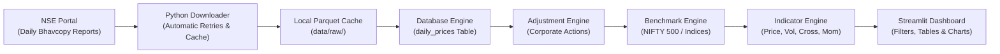
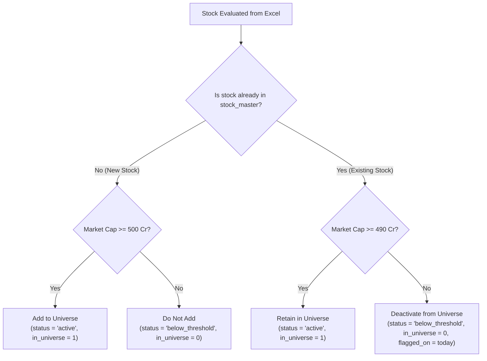

# NSE Screener: Stock Screener & Trading Terminal for NSE India

[](https://www.python.org/downloads/)
[](https://streamlit.io/)
[](https://www.mysql.com/)
[](https://www.sqlalchemy.org/)
[](https://alembic.sqlalchemy.org/)
[](LICENSE)

A clean, fast, and automated stock screener and market terminal for stocks on the **National Stock Exchange of India (NSE)**.

The system automatically downloads official daily NSE Bhavcopy market reports, saves clean price history into a MySQL database with corporate action adjustments (splits/bonuses), calculates modular technical indicators (grouped by price, volume, crossovers, and momentum), and displays filtered stock setups on a modern, dark-themed **Streamlit** web terminal.

---

## 🎯 What Problem Does This Solve?

When scanning and analyzing Indian equities, traders and investors frequently run into several practical challenges:

1. **Penny Stock Clutter & Low Liquidity:** There are over 2,000 listed stocks on the NSE. Scanning all of them includes illiquid, micro-cap stocks with unpredictable swings and execution risks.
2. **Fragile NSE Downloads:** Downloading daily reports directly from the exchange often breaks because of network timeouts, rate limits, or missing trading holiday data.
3. **Corporate Actions Distorting Technicals:** Stock splits and bonus issues create artificial price drops on unadjusted charts, triggering false breakdown signals and invalidating moving averages.
4. **Time-Consuming Manual Scanning:** Finding stocks that have strong uptrends, unusual volume surges, and healthy price momentum usually requires manually checking hundreds of charts each day.

**NSE Screener** automates the entire process:
- **Filters ~1,800 Investable Equities:** Tracks liquid universe stocks using a market cap hysteresis rule (₹500 Cr add / ₹490 Cr retain threshold) via `stock_master`, with an automatic fallback to NIFTY constituents if empty.
- **Smart & Reliable Downloader:** Downloads daily Bhavcopies with browser session handling, retries, and local file caching so you never download the same day twice.
- **Corporate Action Split/Bonus Adjustments:** Detects splits/bonuses using official NSE previous closes and continuously computes split-adjusted prices (`adj_open`, `adj_high`, `adj_low`, `adj_close`).
- **Benchmark Ingestion:** Ingests official NSE index benchmarks (`NIFTY 50`, `NIFTY 500`, etc.) and aligns stock performance against the broader market.
- **Calculates 35+ Domain-Grouped Indicators:** Computes moving averages (SMA, EMA), Bollinger Bands, RSI, MACD, Volume ratios, 52-week rolling highs, and relative strength vs NIFTY 500.
- **Interactive Web Terminal:** Displays ready-to-trade swing setups, customizable tables, and multi-panel candlestick charts with decoupled, high-performance caching.

---

## 🏗️ How It Works (Project Workflow)

The project follows a simple, robust pipeline:



### Key Workflow Highlights
- **Smart Downloader (`src/ingestion/downloader.py`):** Connects to the NSE portal using browser-like headers, handles session cookies, and falls back across new and historical archive formats. Detailed column specifications are documented in [docs/bhavcopy_columns.md](docs/bhavcopy_columns.md).
- **Benchmark Indices (`src/ingestion/benchmark.py`):** Downloads and normalizes official NSE index files with canonical codes detailed in [docs/index_files.md](docs/index_files.md).
- **Safe Database Loader (`src/etl/pipeline.py`):** Loads rows in bounded chunks using dialect-agnostic upserts (`INSERT ... ON DUPLICATE KEY UPDATE` on MySQL, `ON CONFLICT DO UPDATE` on SQLite).
- **Corporate Action Adjustments (`src/etl/adjust.py`):** Detects splits and bonus issues, enforces cross-sectional sanity checks, and vectorizes cumulative factor adjustments.
- **Indicators Grouped by Nature (`src/computation/indicators/`):**
  - `price.py`: SMA, EMA, WMA, Bollinger Bands, ATR, 52-week High/Low, rolling volatility.
  - `volume.py`: Volume SMAs, volume expansion ratios, dry-up volume tests.
  - `crossovers.py`: Golden Cross, Death Cross, MACD crossovers.
  - `momentum.py`: RSI, MACD histogram, Relative Strength vs benchmark, cross-sectional percentile rankings.
- **High-Performance UI (`ui/data.py`):** Uses Streamlit caching with multi-factor cache tokens tied to Parquet mtime and metadata sidecar hashes.

---

## 💻 Tech Stack

| Component | Technologies Used | What It Does |
| :--- | :--- | :--- |
| **Language** | Python 3.11+ | Main programming language for scripts, calculations, and the UI. |
| **Data Processing** | Pandas, NumPy, PyArrow | Fast data cleaning, vectorised rolling calculations, and Parquet caching. |
| **Database** | MySQL 8.0, PyMySQL, SQLite | Stores daily stock prices, trading volumes, and index categories. |
| **Database Layer** | SQLAlchemy 2.0, Alembic | Manages schema migrations, connection pooling, and dialect-agnostic upserts. |
| **Web Dashboard** | Streamlit, Plotly | Interactive terminal with dark mode, custom filters, and candlestick charts. |
| **Networking** | Requests | Downloads market reports with session cookies and retry handlers. |
| **Testing & Quality** | Pytest, Ruff | Automated test suite verifying data logic, indicators, and UI pages. |

---

## 🗄️ Database Migrations with Alembic

The database schema is fully managed with **Alembic** and supports both MySQL (production) and SQLite (testing and offline CI).

```bash
# Apply all pending migrations to current HEAD
alembic upgrade head

# Inspect current revision status
alembic current

# Rollback one migration step (if needed)
alembic downgrade -1
```

### Managed Tables & Migration History

| Revision | Migration File | Target / Table | Purpose & Description |
| :--- | :--- | :--- | :--- |
| `001` | `b52c36bcb5f3` | `daily_prices` | Baseline schema: raw daily OHLCV prices, trade dates, delivery quantities, and series. |
| `002` | `16c821387900` | `daily_prices.prev_close` | Adds official exchange previous close column to detect split and bonus corporate actions. |
| `003` | `da54eaf58152` | `adj_factors`, adjusted columns | Stores detected split/bonus factor history and adds `adj_open`, `adj_high`, `adj_low`, `adj_close`. |
| `004` | `b6162e8d027a` | `benchmark_prices` | Stores daily historical index prices for market benchmarks (`NIFTY 50`, `NIFTY 500`). |
| `005` | `d4cfae65f184` | `index_membership` | Stores historical index constituent membership snapshots. |
| `006` | `78422e33ba2d` | `stock_master` | Master stock directory: defines the active ~1,800 universe stocks with market cap, sector, industry, cap bucket, and hysteresis status. |

#### `stock_master` Table Schema

The `stock_master` table tracks equity eligibility for data ingestion pipelines:

```sql
CREATE TABLE stock_master (
    symbol VARCHAR(32) NOT NULL PRIMARY KEY,
    company_name VARCHAR(255) NOT NULL,
    sector VARCHAR(128) NOT NULL,
    industry VARCHAR(128) NOT NULL,
    cap_bucket VARCHAR(32) NOT NULL,
    market_cap_cr NUMERIC(14, 2) NOT NULL,
    market_cap_asof DATE NOT NULL,
    in_universe BOOLEAN NOT NULL DEFAULT 1,
    status VARCHAR(32) NOT NULL DEFAULT 'active',
    added_on DATE NOT NULL,
    flagged_on DATE NULL,
    benchmark_index VARCHAR(64) NULL,
    source VARCHAR(64) NOT NULL,
    INDEX ix_stock_master_in_universe (in_universe),
    INDEX ix_stock_master_status (status)
);
```

---

## 📐 Quantitative Screener Platform

The project features an extensible, pluggable screener platform (`src/screeners/`) where screening rules are organized strictly by their nature (**Price**, **Volume**, **Crossover**, **Momentum**). Every screener supports execution (`run()`) and deep diagnostic introspection (`explain()`), including **near-miss detection** (identifying equities that passed all criteria except a single bottleneck condition).

### 1. Registered Systematic Screeners

| Key | Name | Category | Primary Setup Logic |
| :--- | :--- | :--- | :--- |
| `minervini_trend_template` | **Minervini Trend Template** | Trend | Mark Minervini's 8-point Stage 2 trend template (Close > 50 > 150 > 200 SMA, upward-sloping 200 SMA, +30% from 52W Low, within 25% of 52W High, RS leader). |
| `breakout_52w_volume` | **52W High Breakout + Vol** | Breakout | Price within 2% or breaking 52-week High with heavy institutional volume surge (>= 2.0x 20D SMA) and minimum liquidity. |
| `rsi_pullback_uptrend` | **RSI Pullback in Uptrend** | Pullback | Orderly, low-volume pullback (Vol <= 1.2x SMA) to bull market support zone (RSI 40-55) in an established uptrend (Close > 50 SMA > 200 SMA). |
| `vcp_lite` | **VCP Lite (Volatility Contraction)** | Breakout | Volatility compression (ATR% <= 75% of 60D max ATR% or narrow Bollinger width) accompanied by volume dry-up (Vol <= 0.7x SMA) in an uptrend. |
| `rs_leaders` | **Relative Strength Leaders** | Quantitative | Outperforming equities with RS 63D > 10% vs NIFTY 500 or top 20th percentile 252D return rank, trading above moving averages. |
| `composite_trend` | **Composite Trend Regime** | Trend | Multi-indicator regime confluence: Close > 20 EMA & 50 SMA, recent Golden Cross or MA support, bullish MACD, RSI >= 50, and healthy volume. |
| `swing_volume` | **Swing + Volume** | Swing | Uptrend alignment (EMA 20 > SMA 50 > SMA 200), within 15% of 52-week high, volume surge (> 1.5x 20D SMA), 20D SMA volume > 250k. |
| `swing_momentum` | **Swing With Momentum** | Swing | Meets all Swing + Volume criteria with multi-quarter velocity (120D return >= 30%) and an anti-climax exhaustion guard (60D return <= 40%). |
| `above_50_sma` / `above_200_sma` | **Above 50 / 200 SMA** | Classic | Classical moving average threshold filters. |
| `golden_cross` / `death_cross` | **Golden / Death Cross** | Classic | State transition crossovers between 50 SMA and 200 SMA. |
| `near_52w_high` / `near_52w_low` | **Near 52W High / Low** | Classic | Proximity filters to 52-week extremes. |
| `rsi_oversold` / `rsi_overbought` | **RSI Oversold / Overbought**| Classic | Momentum oscillator extremes (RSI < 30 or RSI > 70). |
| `bullish_macd_crossover` | **Bullish MACD Cross** | Classic | MACD line crossing above 9-day signal line. |
| `high_volatility` / `bollinger_squeeze` | **Volatility & Squeeze** | Classic | Historical volatility thresholds and Bollinger Band compression. |

---

### 2. Grouped Conditions Architecture

Screening conditions are decoupled from screeners and modularized in `src/screeners/conditions/` by their nature:
- **`price.py`**: Moving average alignment, price boundaries, 52-week proximity, volatility, and ATR contraction.
- **`volume.py`**: Volume surges, liquidity floors, and volume dry-up ratios.
- **`crossover.py`**: Golden Cross, Death Cross, MACD crossovers, and recent crossing events (10-session lookback).
- **`momentum.py`**: RSI support/extremes, benchmark relative strength, cross-sectional percentile rankings, and return velocity caps/floors.

### 3. Programmatic Usage Example

```python
from src.screeners import get_screener

# Instantiate any registered screener
screener = get_screener("minervini_trend_template")

# Run screener to get passing stocks
passing_stocks = screener.run(snapshot_df)

# Deep diagnostic explainability with near-miss analysis
explained_df = screener.explain(snapshot_df)

# Find near-miss stocks that failed by only 1 condition
near_misses = explained_df[explained_df["near_miss"]]
print(near_misses[["symbol", "near_miss_on"]])
```

---

## 🚀 Quickstart Guide (macOS / VS Code)

Follow these steps to get the project up and running locally:

### 1. Clone the Project & Create Virtual Environment
```bash
# Clone the repository
git clone https://github.com/YashSharma333/nse-screener.git
cd nse-screener

# Create and activate virtual environment
python3 -m venv .venv
source .venv/bin/activate

# Install required packages
pip install --upgrade pip
pip install -r requirements-dev.txt
```

### 2. Set Up Environment Variables
Copy the sample environment file:
```bash
cp .env.example .env
```
Open `.env` and set your local MySQL connection settings:
```env
MYSQL_HOST=localhost
MYSQL_PORT=3306
MYSQL_USER=root
MYSQL_PASSWORD=your_password
MYSQL_DB=nse_screener
```

### 3. Initialize the Database Schema
Ensure your MySQL server is running, then run Alembic migrations:
```bash
alembic upgrade head
```

### 4. Ingest Market Data via CLI

The CLI tool `run_pipeline.py` provides end-to-end management for downloading Bhavcopy reports, managing the stock universe, running corporate action adjustments, and caching technical indicators.

#### Command Reference & Copy-Paste Examples

##### 1. Import or Update the Stock Universe (`--import-universe`)
```bash
# Preview universe import without modifying the database (Dry-run by default)
python run_pipeline.py --import-universe data/universe/m-cap_1.xlsx

# Confirm and save changes to the database
python run_pipeline.py --import-universe data/universe/m-cap_1.xlsx --yes

# Customize market-cap thresholds (e.g. ₹500 Cr to add, ₹490 Cr to retain)
python run_pipeline.py --import-universe data/universe/m-cap_1.xlsx --add-threshold 500 --keep-threshold 490 --yes
```
* **Why it exists:** NSE lists over 2,200 stocks, but many are micro-caps with poor liquidity and wide bid-ask spreads. This command imports an investable universe (~1,800 stocks with market cap ≥ ₹490/₹500 Cr) and classifies them in `stock_master`.
* **What it changes:** Updates the `stock_master` table using the 500/490 Cr hysteresis rule. It also outputs an audit report at `reports/universe_import_report.csv` detailing status breakdowns, sector distributions, and any symbol discrepancies.

##### 2. Fill Missing Symbols from Cache (`--fill-missing-symbols`)
```bash
# Scan all stored trading dates and fill missing universe stocks from Bhavcopy cache
python run_pipeline.py --fill-missing-symbols

# Target a specific historical date range
python run_pipeline.py --fill-missing-symbols --start 2024-01-01 --end 2024-12-31
```
* **Why it exists:** When you add new symbols to `stock_master`, prior historical sessions in your database might only contain rows for previously tracked stocks. This command iterates date-by-date through every trading session in `daily_prices`, identifies any active universe symbol that lacks a row, and populates it directly from `data/raw/bhavcopy_cache/<date>.parquet` (or downloads the session if the cache file is missing). Stocks listed more recently (IPOs) naturally have fewer rows and are handled cleanly.
* **What it changes:** Bulk upserts missing price rows into `daily_prices`, runs `rebuild_adjusted` for added symbols, and refreshes the indicator cache.

##### 3. Incremental Daily Ingestion (`--incremental`)
```bash
# Quick daily update: downloads and ingests only the latest sessions
python run_pipeline.py --incremental
```
* **Why it exists:** Perfect for daily scheduled automation after market close (e.g. at 18:30 IST). It checks the most recent trading date in your database and only downloads subsequent sessions (typically the last 1–5 days), finishing in seconds.
* **What it changes:** Appends new daily rows for universe stocks to `daily_prices`, detects corporate actions, and updates the indicator cache.

##### 4. Historical Backfill in Chunks (`--backfill`)
```bash
# Backfill the past 365 calendar days in reverse chronological chunks
python run_pipeline.py --backfill --days-back 365

# Full historical backfill (default: 1100 days, ~3 years)
python run_pipeline.py --backfill

# Deep 10-year backfill (chunked into 100-day windows to prevent memory spikes)
python run_pipeline.py --backfill --days-back 3650 --chunk-size 100
```
* **Why it exists:** Populates historical OHLCV prices backwards from today for moving averages, 52-week highs/lows, and backtesting. Downloading in bounded chunks prevents network timeouts and memory pressure.
* **What it changes:** Inserts historical price rows for active universe stocks into `daily_prices`.

##### 5. Ingest Benchmark Indices (`--benchmarks`)
```bash
# Ingest benchmark prices for NIFTY 50, NIFTY 500, etc.
python run_pipeline.py --benchmarks

# Ingest benchmarks for a specific date range
python run_pipeline.py --benchmarks --start 2020-01-01 --end 2024-12-31
```
* **Why it exists:** Key quantitative strategies (such as Relative Strength / RS Ratings) compare stock performance against the broader market index (NIFTY 500).
* **What it changes:** Inserts daily index levels into `benchmark_prices` and refreshes the indicator cache.

##### 6. Recompute Corporate Action Adjustments (`--rebuild-adjusted`)
```bash
# Recompute split and bonus factors across the full price history
python run_pipeline.py --rebuild-adjusted
```
* **Why it exists:** Stock splits and bonus issues create artificial price drops on unadjusted charts. This command recalculates split/bonus factors chronologically from official exchange previous closes, producing smooth, continuous price series.
* **What it changes:** Populates `adj_factors` and updates `adj_open`, `adj_high`, `adj_low`, `adj_close` in `daily_prices`.

##### 7. Recheck Non-Trading Days (`--recheck-non-trading`)
```bash
# Re-probe cached non-trading days between specific dates
python run_pipeline.py --recheck-non-trading --start 2024-01-01 --end 2024-12-31
```
* **Why it exists:** If a session was previously marked as non-trading due to an exchange server delay or transient network drop, this command clears the cached non-trading marker and re-probes NSE servers to retrieve the file.
* **What it changes:** Clears local non-trading cache entries and ingests any recovered trading days.

##### 8. Purge Bogus Sessions (`--purge-bogus-sessions`)
```bash
# Detect bogus duplicated weekend/holiday sessions (Dry-run by default)
python run_pipeline.py --purge-bogus-sessions

# Inspect reports/bogus_sessions.csv, then confirm deletion:
python run_pipeline.py --purge-bogus-sessions --yes
```
* **Why it exists:** On some non-trading holidays or weekends, NSE web servers mistakenly served the prior day's Bhavcopy instead of returning an HTTP 404 error. This command detects stored sessions where prices and volumes are exact duplicates of an adjacent session and trade dates mismatch.
* **What it changes:** Writes a diagnostic audit report to `reports/bogus_sessions.csv` and deletes the bogus session rows from `daily_prices` when `--yes` is specified.

##### 9. Refresh Indicator Cache (`--refresh-cache`)
```bash
# Rebuild the pre-computed indicator Parquet cache directly from MySQL
python run_pipeline.py --refresh-cache
```
* **Why it exists:** Computes all 35+ technical indicators across the active universe without downloading any files from the internet, updating the local fast Parquet cache.
* **What it changes:** Regenerates `data/processed/indicators.parquet` and its metadata sidecar `indicators.meta.json`.

---

#### 🌟 Recommended Order for a Fresh 10-Year Build

When setting up a fresh database from scratch or reconstructing 10 years of historical data, run the commands in this exact sequence:

```bash
# Step 1: (Optional) Back up existing database if you have previous data
# mysqldump -u root -p nse_screener > backup_$(date +%F).sql

# Step 2: Apply database migrations to create all required tables
alembic upgrade head

# Step 3: Import the stock universe from the official market-cap Excel file
python run_pipeline.py --import-universe data/universe/m-cap_1.xlsx --yes

# Step 4: Fill missing symbols from any locally cached Bhavcopy files
python run_pipeline.py --fill-missing-symbols

# Step 5: Backfill historical market data (e.g. 10 years / ~3650 days)
python run_pipeline.py --backfill --days-back 3650 --chunk-size 100

# Step 6: Ingest benchmark indices (NIFTY 500, NIFTY 50)
python run_pipeline.py --benchmarks --start 2014-01-01

# Step 7: Detect corporate actions (splits/bonuses) and compute indicators
python run_pipeline.py --rebuild-adjusted
```

**Why this exact order matters:**
1. **Migrations first:** Sets up the schema (`stock_master`, `daily_prices`, `adj_factors`) with all necessary indexes.
2. **Universe import second:** Establishes the ~1,800 active universe symbols in `stock_master`. Subsequent backfills and ingestion will automatically filter for these symbols instead of wasting bandwidth and disk space on penny stocks.
3. **Fill missing third:** Scans any existing Bhavcopy Parquet files in `data/raw/bhavcopy_cache/` so already-downloaded sessions are ingested immediately without hitting the network.
4. **Backfill fourth:** Downloads historical sessions backwards in bounded 100-day chunks, storing data only for active universe symbols.
5. **Benchmarks fifth:** Provides the broader market benchmark history required for Relative Strength (RS) calculations.
6. **Rebuild adjusted sixth:** Processes full price history to detect all stock splits and bonuses chronologically, calculates adjusted prices, and generates the high-performance indicator cache in one clean pass.

### 5. Launch the Dashboard
Start the web dashboard:
```bash
streamlit run ui/Dashboard.py
```
Open [http://localhost:8501](http://localhost:8501) in your web browser.

> [!NOTE]
> **Data Availability:** Synthetic demo-mode data was removed in Phase 1; live MySQL or Parquet cache is required to run the application. If your database is empty, the dashboard displays a setup banner with the exact CLI commands to initialize and backfill data.

### 6. Run the Test Suite & Linters
```bash
# Run full test suite with coverage
pytest

# Run linter and formatter check
ruff check .
ruff format --check .
```

---

## 🌐 Market Universe and Stock Master

NSE lists more than 2,200 stocks, but many trade only a few hundred shares per day or represent bankrupt/dormant companies. To ensure reliable screener signals, **NSE Screener** maintains an investable universe of high-quality equities in the `stock_master` table using a market capitalization **hysteresis rule**.

### 1. The 500 / 490 Crore Hysteresis Rule

When stocks sit right near a fixed cut-off threshold, normal daily price fluctuations cause them to cross back and forth across the boundary, causing annoying "churn" where stocks are repeatedly added and removed. To eliminate this issue, the pipeline uses a two-level **hysteresis rule**:



* **First Import (table empty):** Every stock with `market_cap >= 490` Crore (`--keep-threshold`) is immediately added as `status='active'` and `in_universe=True`. On the baseline 2,297-row Chartink file, exactly **1,808 stocks** qualify.
* **Later Imports (table populated):**
  - A stock **not yet** in the universe is added only if its market cap reaches or exceeds **₹500 Crore** (`--add-threshold`).
  - An **existing** active universe stock is retained as long as its market cap stays at or above **₹490 Crore** (`--keep-threshold`).
  - If an existing stock drops below ₹490 Crore, it is marked as `status='below_threshold'`, `in_universe=False`, and `flagged_on=today`.
* **Missing from File:** Any symbol that exists in historical price records but is completely absent from the new file is marked as `status='not_in_file'` and `in_universe=False`.
* **Data Safety Guarantee:** Price history rows are **NEVER deleted** when a stock's status changes. Even if a stock falls below the threshold or gets delisted, its historical candles and technical indicators remain permanently stored in `daily_prices` to ensure backtesting integrity.

### 2. Status Lifecycle Values

| Status | In Universe? | Description |
| :--- | :--- | :--- |
| `active` | **Yes (`1`)** | Stock meets market cap criteria and is actively ingested and updated by daily pipelines. |
| `below_threshold` | **No (`0`)** | Stock's market capitalization has fallen below ₹490 Crore. Ingestion is paused, but existing price history is preserved. |
| `not_in_file` | **No (`0`)** | Stock exists in previous database history but was omitted from the latest imported file (e.g. delisted or renamed). |

### 3. Excel File Format & Location

* **Standard File Path:** `data/universe/m-cap_1.xlsx`
* **Expected Columns:**
  1. `Sr.` — Serial number
  2. `Stock Name` — Official company name (e.g., `Reliance Industries Ltd.`)
  3. `Symbol` — NSE equity symbol (e.g., `RELIANCE`)
  4. `close` — Most recent close price
  5. `industry` — Sub-industry classification
  6. `marketcapname` — Market cap bucket (`Large Cap`, `Mid Cap`, `Small Cap`, `Micro Cap`)
  7. `sector` — Macro-economic sector
  8. `market_cap` — Market capitalization in ₹ Crore
  9. `Add Column` — Supplementary data column

### 4. Bi-Annual Refresh Routine

NSE publishes official semi-annual market capitalization reclassifications in June and December. Follow this simple routine twice a year to update your universe:

1. **Obtain the latest list:** Export the latest market cap list from NSE or Chartink and save it as `data/universe/m-cap_1.xlsx`.
2. **Run a Dry-Run Comparison:**
   ```bash
   python run_pipeline.py --import-universe data/universe/m-cap_1.xlsx
   ```
3. **Inspect the Audit Report:** Open `reports/universe_import_report.csv` to review:
   - Breakdown of counts by `status`, `sector`, and `cap_bucket`.
   - Symbols present in the Excel file that never appeared in any Bhavcopy (e.g. symbol renames or special characters like `&` or `-`).
   - Database symbols missing from the new file.
4. **Apply Universe Changes:**
   ```bash
   python run_pipeline.py --import-universe data/universe/m-cap_1.xlsx --yes
   ```
5. **Backfill History for Newly Added Stocks:**
   ```bash
   python run_pipeline.py --fill-missing-symbols
   ```

---

## 🛡️ Special Trading Sessions and Data Safety

Indian financial markets have unique trading schedules and quirks that standard scrapers often mishandle. **NSE Screener** incorporates dedicated defensive safety mechanisms:

### 1. Why Every Calendar Day is Probed

Unlike Western markets that strictly trade Monday through Friday, the NSE occasionally schedules real live trading sessions on weekends and public holidays:
* **Diwali Muhurat Trading:** An auspicious 1-hour evening trading session held every year on Diwali (frequently falling on a Saturday or Sunday).
* **Disaster Recovery Live Sessions:** Exchange-mandated weekend sessions to test live failover to disaster recovery data centers (e.g. Saturday sessions on March 2, 2024 and May 18, 2024).

Skipping weekends by default would miss these genuine, exchange-recorded trading days. Therefore, the pipeline probes every calendar day without assuming a static weekend schedule.

### 2. NSE Non-Trading Day Serving Behavior & TradeDate Validation

When requesting a report for a non-trading Saturday, Sunday, or market holiday, the NSE web portal frequently serves the *previous* or *next* trading day's Bhavcopy rather than returning an HTTP 404 error!

If an ingestion tool simply checks for a successful HTTP 200 response, it will repeatedly save duplicate market data under the wrong date, corrupting charts and creating false candlestick patterns.

**How NSE Screener prevents this:**
* Every downloaded file is inspected for its internal `TradeDate` header.
* If the file's internal `TradeDate` does not match the requested date, the pipeline recognizes it as a non-trading session.
* The date is cached as non-trading locally so subsequent runs never download it again.

### 3. Detecting & Purging Bogus Duplicate Sessions (`--purge-bogus-sessions`)

If historical data was ingested prior to TradeDate validation, duplicate sessions might exist in your database. The CLI provides a dedicated detection and cleaning tool:

```bash
# 1. Run detection in dry-run mode (safe, deletes nothing)
python run_pipeline.py --purge-bogus-sessions

# 2. Check the generated report
cat reports/bogus_sessions.csv

# 3. Confirm purge to delete bogus duplicated records
python run_pipeline.py --purge-bogus-sessions --yes
```

**How to read `reports/bogus_sessions.csv`:**
- `date`: The erroneous non-trading date found in the database.
- `matched_date`: The real trading date whose prices were duplicated.
- `reason`: Specific matching criteria (e.g., `identical_daily_prices_and_volumes`).
- `row_count`: Number of corrupted price rows flagged for removal.

### 4. The 3-Day Recent Date Rule

NSE servers occasionally experience publication delays where current-day Bhavcopy reports are uploaded late in the evening or early the following morning.
* Dates within **3 days** of today are treated as "recent".
* If a file is not yet available for a recent date, it is **not** permanently marked as a non-trading holiday.
* The next incremental run will automatically re-attempt downloading the file once published.

---

## ⚡ Indicator Window and Cache Performance

### 1. Rolling Indicator History Window (`INDICATOR_HISTORY_YEARS = 2`)

Over 10 years of trading data across ~1,800 stocks amounts to more than **3.5 million daily price rows**. Computing and loading all 35+ technical indicators across 10 years into memory for every screen would consume over 8 GB of RAM and result in slow UI page loads.

To solve this, `config/settings.py` defines:
```python
INDICATOR_HISTORY_YEARS = 2
INDICATOR_WARMUP_BARS = 300
```

* **Target Window:** Indicator calculation maintains a rolling 2-year window of indicator snapshots, keeping cache sizes compact (~30 MB Parquet) and dashboard page loads virtually instantaneous (< 0.5s).
* **Warm-up Calculation Guarantee:** Moving averages like `sma_200` or `ema_200` require at least 200 previous trading sessions to produce valid numbers. To prevent empty (`NaN`) values on day 1 of the 2-year window, the calculator loads at least **300 warm-up bars** of historical data prior to the cutoff date, computes all indicators, and then filters to the 2-year window. Every single row in the cached window is 100% mathematically valid and complete!

### 2. Sidecar Metadata & Automatic Invalidation

The Parquet cache at `data/processed/indicators.parquet` is paired with a metadata sidecar `indicators.meta.json`:
* Stores `indicators_schema_version = 4` and `indicator_history_years = 2`.
* Tracks database states: `db_max_date`, `adj_factors_count`, `adj_factors_max_detected_at`, and `benchmark_max_date`.
* Whenever new daily prices are ingested, corporate actions are added, or settings change, the system automatically detects cache staleness and recomputes the indicator snapshot seamlessly.

---

## 📂 Project Structure

```
nse-screener/
├── config/
│   └── settings.py               # Central configuration (paths, INDICATOR_HISTORY_YEARS)
├── data/
│   ├── raw/bhavcopy_cache/       # Local Parquet cache for downloaded market files
│   ├── processed/                # Pre-computed indicator snapshots & sidecars (.meta.json)
│   └── universe/                 # Market cap universe Excel files (e.g. m-cap_1.xlsx)
├── docs/
│   ├── bhavcopy_columns.md       # Raw Bhavcopy format specification & historical URL tests
│   └── index_files.md            # Verified NSE benchmark index codes & URLs
├── migrations/                   # Alembic database migration revisions
│   └── versions/
│       ├── b52c36bcb5f3_001_baseline_schema.py
│       ├── 16c821387900_002_add_prev_close_to_daily_prices.py
│       ├── da54eaf58152_003_add_adj_factors_and_adjusted_prices.py
│       ├── b6162e8d027a_004_create_benchmark_prices.py
│       ├── d4cfae65f184_005_create_index_membership.py
│       └── 78422e33ba2d_006_create_stock_master.py  # Stock master universe table migration
├── reports/                      # Audit and diagnostic reports
│   ├── universe_import_report.csv # Universe import audit (counts, sectors, symbol discrepancies)
│   └── bogus_sessions.csv        # Detected bogus/duplicate weekend trading sessions
├── src/
│   ├── computation/
│   │   └── indicators/           # Technical indicators grouped by nature:
│   │       ├── price.py          # Price indicators (MAs, BB, ATR, 52W High/Low)
│   │       ├── volume.py         # Volume indicators (Volume SMA, Volume ratio)
│   │       ├── crossovers.py     # Crossover indicators (Golden/Death cross, MACD)
│   │       ├── momentum.py       # Momentum indicators (RSI, RS vs benchmark)
│   │       └── calculator.py     # TechnicalCalculator orchestrator facade
│   ├── db/
│   │   ├── data_service.py       # Indicator cache loader, sidecar validation & universe symbols
│   │   ├── models.py             # SQLAlchemy models (DailyPrice, AdjFactor, StockMaster, etc.)
│   │   ├── session.py            # MySQL engine, connection pooling & health checks
│   │   └── upsert.py             # Dialect-agnostic upsert helper (MySQL & SQLite)
│   ├── etl/
│   │   ├── adjust.py             # Corporate action split/bonus detector & adjuster
│   │   └── pipeline.py           # Bhavcopy ETL, universe import, fill missing & backfill
│   ├── ingestion/
│   │   ├── benchmark.py          # Benchmark index downloader & loader
│   │   ├── downloader.py         # NSE Bhavcopy file downloader with retries
│   │   └── index_constituents.py # NIFTY constituent fetcher & fallback snapshotter
│   └── screeners/                # Extensible Screener Platform
│       ├── base.py               # Screener abstract base class & explainability
│       ├── registry.py           # Pluggable screener registry & discovery
│       ├── conditions/           # Screening conditions grouped by nature:
│       │   ├── price.py          # Price-based screening conditions
│       │   ├── volume.py         # Volume & liquidity screening conditions
│       │   ├── crossover.py      # Line crossing & transition conditions
│       │   └── momentum.py       # RSI, RS & return velocity conditions
│       ├── swing.py              # Capstone Swing + Volume & Swing With Momentum
│       ├── classic.py            # 11 classic technical filter screens
│       └── strategies.py         # 6 systematic strategies (Minervini, VCP, etc.)
├── tests/                        # Comprehensive unit & integration tests
│   └── test_stock_master_universe.py # Unit tests for universe hysteresis, fill missing & window
├── ui/
│   ├── app.py                   # Streamlit multipage app router
│   ├── data.py                  # Streamlit cache wrapper with multi-factor tokens
│   ├── Dashboard.py             # Main screener dashboard page
│   ├── components/              # Reusable UI components (terminal header, screener view)
│   └── pages/
│       ├── 2_swing_volume.py    # Screener page: Swing + Volume
│       ├── 3_swing_momentum.py  # Screener page: Swing With Momentum
│       └── 4_screener_explorer.py # Interactive Screener Explorer & Diagnostics
├── pyproject.toml               # Project configuration, ruff & pytest-cov settings
├── requirements.txt             # Runtime Python dependencies (pinned openpyxl)
├── requirements-dev.txt         # Development & test dependencies
└── run_pipeline.py              # CLI tool for data ingestion and ETL operations
```

---

## 👤 Author
- **Developer:** Yash Sharma
- **Focus:** Data Engineering, Python Development & Stock Market Analytics
