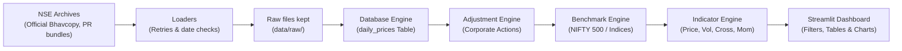

# NSE Screener: Stock Scanner & Trading Terminal for NSE India

[](https://www.python.org/downloads/)
[](https://streamlit.io/)
[](https://www.mysql.com/)
[](https://www.sqlalchemy.org/)
[](https://alembic.sqlalchemy.org/)
[](LICENSE)

A clean, fast, and automated stock scanner and market terminal for stocks on the **National Stock Exchange of India (NSE)**.

The system automatically downloads official daily NSE Bhavcopy market reports, saves clean price history into a MySQL database with corporate action adjustments (splits/bonuses), calculates technical indicators (one plain function per indicator, any length, any column), and shows the market snapshot on a modern, dark-themed **Streamlit** web terminal. Scans are built from your own conditions (see below); there are no prebuilt screeners.

---

## 🎯 What Problem Does This Solve?

When scanning and analyzing Indian equities, traders and investors frequently run into several practical challenges:

1. **Penny Stock Clutter & Low Liquidity:** There are over 2,000 listed stocks on the NSE. Scanning all of them includes illiquid, micro-cap stocks with unpredictable swings and execution risks.
2. **Fragile NSE Downloads:** Downloading daily reports directly from the exchange often breaks because of network timeouts, rate limits, or missing trading holiday data.
3. **Corporate Actions Distorting Technicals:** Stock splits and bonus issues create artificial price drops on unadjusted charts, triggering false breakdown signals and invalidating moving averages.
4. **Time-Consuming Manual Scanning:** Finding stocks that have strong uptrends, unusual volume surges, and healthy price momentum usually requires manually checking hundreds of charts each day.

**NSE Screener** automates the entire process:
- **Screens Every Regular Series:** Loads all `EQ`, `BE`, `BZ`, `SM` and `ST` stocks (delisted ones stay in the history) and lets the dashboard filter by series and minimum market cap.
- **Smart & Reliable Downloader:** Downloads official daily Bhavcopies with browser session handling, retries and date checks, and skips days that are already stored.
- **Corporate Action Split/Bonus Adjustments:** Uses NSE's official corporate actions (exact ratios, never guessed from prices) to compute split-adjusted prices (`adj_open`, `adj_high`, `adj_low`, `adj_close`); raw prices are never changed.
- **Benchmark Ingestion:** Ingests official NSE index benchmarks (`NIFTY 50`, `NIFTY 500`, etc.) and aligns stock performance against the broader market.
- **Calculates 35+ Domain-Grouped Indicators:** Computes moving averages (SMA, EMA), Bollinger Bands, RSI, MACD, Volume ratios, 52-week rolling highs, and relative strength vs NIFTY 500.
- **Interactive Web Terminal:** Displays the market snapshot with customizable tables, and (stock inspector component) multi-panel candlestick charts with decoupled, high-performance caching.

---

## 🏗️ How It Works (Project Workflow)

The project follows a simple, robust pipeline:



### Key Workflow Highlights
- **Official File Loaders (`src/ingestion/nse_files.py`, `price_loader.py`, `mcap_loader.py`):** One polite download helper with browser-like headers, retries and a check that the date inside each file equals the requested date; parsers for both Bhavcopy formats (old format until 2023-12-29, UDiFF from 2024-01-01). Column specifications: [docs/bhavcopy_columns.md](docs/bhavcopy_columns.md).
- **Benchmark Indices (`src/ingestion/benchmark.py`):** Downloads and normalizes official NSE index files with canonical codes detailed in [docs/index_files.md](docs/index_files.md).
- **Safe Database Writes (`src/db/upsert.py`):** Loads rows in bounded chunks using dialect-agnostic upserts (`INSERT ... ON DUPLICATE KEY UPDATE` on MySQL, `ON CONFLICT DO UPDATE` on SQLite).
- **Official Corporate Actions (`src/ingestion/corporate_actions.py`):** Downloads NSE's official corporate actions (exact split and bonus ratios), symbol changes and the listing master with one session and one retry method, keeps the raw responses and fails loudly if NSE changes a format. Beginner guide: [docs/corporate_actions.md](docs/corporate_actions.md).
- **Corporate Action Adjustments (`src/etl/adjust.py`):** Applies the official split and bonus factors, enforces cross-sectional sanity checks, and vectorizes cumulative factor adjustments.
- **Daily Routine (`src/etl/daily_update.py`):** The seven-step `--update` that keeps everything current.
- **Indicators Grouped by Nature (`src/computation/indicators/`):**
  - `price.py`: SMA, EMA, WMA, Bollinger Bands, ATR, 52-week High/Low, rolling volatility.
  - `volume.py`: Volume SMAs, volume expansion ratios, dry-up volume tests.
  - `crossovers.py`: Golden Cross, Death Cross, MACD crossovers.
  - `momentum.py`: RSI, MACD histogram, Relative Strength vs benchmark, cross-sectional percentile rankings.
- **Read-only UI (`ui/data.py`):** The dashboard only reads the Parquet cache (through `src/computation/cache_reader.py`). It never opens MySQL and never rebuilds the cache. Streamlit caching uses cache tokens tied to the Parquet mtime and the metadata sidecar hash, so new data shows up as soon as the file changes.

---

## 💻 Tech Stack

| Component | Technologies Used | What It Does |
| :--- | :--- | :--- |
| **Language** | Python 3.11+ | Main programming language for scripts, calculations, and the UI. |
| **Data Processing** | Pandas, NumPy, PyArrow | Fast data cleaning, vectorised rolling calculations, and Parquet caching. |
| **Database** | MySQL 8.0, PyMySQL, SQLite | Stores raw and adjusted daily prices, volumes, market cap and official NSE reference data. |
| **Database Layer** | SQLAlchemy 2.0, Alembic | Manages schema migrations, connection pooling, and dialect-agnostic upserts. |
| **Web Dashboard** | Streamlit, Plotly | Interactive terminal with dark mode, custom filters, and candlestick charts. |
| **Networking** | Requests | Downloads market reports with session cookies and retry handlers. |
| **Testing & Quality** | Pytest, Ruff | Automated test suite verifying data logic, indicators, and UI pages. |

---

## 🗄️ Database Migrations with Alembic

The database schema is fully managed with **Alembic** and supports both MySQL (production) and SQLite (testing and offline CI).

```bash
# Apply all pending migrations to current HEAD
alembic upgrade head

# Inspect current revision status
alembic current

# Rollback one migration step (if needed)
alembic downgrade -1
```

### Managed Tables & Migration History

| Revision | Migration File | Target / Table | Purpose & Description |
| :--- | :--- | :--- | :--- |
| `001` | `b52c36bcb5f3` | `daily_prices` | Baseline schema: raw daily OHLCV prices, trade dates, delivery quantities, and series. |
| `002` | `16c821387900` | `daily_prices.prev_close` | Adds official exchange previous close column to detect split and bonus corporate actions. |
| `003` | `da54eaf58152` | `adj_factors`, adjusted columns | Stores detected split/bonus factor history and adds `adj_open`, `adj_high`, `adj_low`, `adj_close`. |
| `004` | `b6162e8d027a` | `benchmark_prices` | Stores daily historical index prices for market benchmarks (`NIFTY 50`, `NIFTY 500`). |
| `005` | `d4cfae65f184` | `index_membership` | Stores historical index constituent membership snapshots. |
| `006` | `78422e33ba2d` | `stock_master` | (removed by 010) Master stock directory: defines the active ~1,800 universe stocks with market cap, sector, industry, cap bucket, and hysteresis status. |
| `007` | `f7c18050340f` | `symbol_alias`, `stock_master.renamed_to` | (removed by 010) Symbol alias registry and renamed tracking: stores mappings between old and new equity ticker symbols, effective dates, verification classifications, and implied ratios; adds nullable `renamed_to` column on `stock_master`. |
| `008` | `a3c5e1b7d902` | `corporate_actions`, `symbol_changes` | Official NSE corporate actions (one row per action part, with exact `price_factor` for splits, bonuses and consolidations) and official symbol changes. See [docs/corporate_actions.md](docs/corporate_actions.md). |
| `009` | `094ee0ad95bf` | `daily_prices`, `securities` | Clean raw-first schema: recreates `daily_prices` with `series`, `isin`, `market_cap` and unique `(symbol, date)` key (no `index_name`); creates `securities` master table; drops legacy `index_membership`, `stock_master`, and `symbol_alias`; empties `adj_factors`. |
| `010` | `5e2b8c4d7a10` | legacy tables, `daily_prices.index_name` | Drops `stock_master`, `symbol_alias`, `index_membership`, `technical_indicators` and `index_name` (re-created empty by the old `init_db()`); downgrade restores `technical_indicators`. |

The tables used today are `daily_prices`, `securities`, `symbol_changes`, `corporate_actions`, `adj_factors` and `benchmark_prices`. Migration 010 removed `stock_master`, `symbol_alias`, `index_membership`, `technical_indicators` and `daily_prices.index_name`, which only the old ETL used.

---

## 📐 Conditions and Strategies

There are **no prebuilt screeners** (removed in CL-24B). The product is a Chartink-style scanner: you compose a condition from prices, indicators with your own numbers, index prices, math, comparisons and groups, and the condition is true or false per stock per day.

- **Conditions** (`src/conditions/`): a condition is a JSON tree of parts (price fields, indicators with custom numbers, index prices, window max/min/sum/count, math, comparisons incl. crossed above/below, groups all / any / any_1 / any_2). `parse_condition`, `evaluate`, `save_condition` and `load_condition` are the entry points; the answer is true or false per stock per day and never looks ahead. See [docs/condition_engine.md](docs/condition_engine.md).
- **Indicators** (`src/computation/indicators/`): one plain function per indicator with default numbers, and a resolver that computes any custom number on demand.
- **Strategies** (`src/strategies/`, `strategies/library/*.json`): a complete trading plan. The entry is a condition tree (`entry.condition`); the plan also holds the stop, target, trailing stop, sizing and costs. See [docs/strategy_engine.md](docs/strategy_engine.md).

```bash
python -m src.strategies.cli list
python -m src.strategies.cli validate strategies/library/swing_volume_atr_trail.json
python -m src.strategies.cli signals strategies/library/swing_volume_atr_trail.json
```

---

## 🚀 Quickstart Guide (macOS / VS Code)

Follow these steps to get the project up and running locally:

### 1. Clone the Project & Create Virtual Environment
```bash
# Clone the repository
git clone https://github.com/YashSharma333/nse-screener.git
cd nse-screener

# Create and activate virtual environment
python3 -m venv .venv
source .venv/bin/activate

# Install required packages
pip install --upgrade pip
pip install -r requirements-dev.txt
```

### 2. Set Up Environment Variables
Copy the sample environment file:
```bash
cp .env.example .env
```
Open `.env` and set your local MySQL connection settings:
```env
MYSQL_HOST=localhost
MYSQL_PORT=3306
MYSQL_USER=root
MYSQL_PASSWORD=your_password
MYSQL_DB=nse_screener
```

### 3. Initialize the Database Schema
Ensure your MySQL server is running, then run Alembic migrations:
```bash
alembic upgrade head
```

### 4. Run the Data Pipeline (CLI)

`run_pipeline.py` has one flag per operation. `python run_pipeline.py --help` lists them all; running it without a flag only prints that help.

#### Command Reference & Copy-Paste Examples

##### 1. Daily Routine (`--update`)
```bash
# Run the entire daily routine in order with fail-fast error handling
python run_pipeline.py --update
```
* **Why it exists:** One command for the whole daily routine. It runs 7 steps in sequence and stops at the first failure with a clear message naming the step:
  1. `load_prices`: day after the last loaded date up to **today** (all regular series; if NSE has not published today's file yet, the 404 is not remembered as a holiday and the next run tries again). First it retries every calendar day between the first and last stored date that has no prices and is not a confirmed non-trading day (a day that failed once, for example an HTML block page); days still missing are listed in `reports/price_gaps.csv` and counted in the summary
  2. `market_cap`: market cap for the new dates (from 2024-02-01; older dates stay NULL)
  3. `refresh_reference_data`: `EQUITY_L.csv`, `symbolchange.csv` and NSE's official corporate actions (splits, bonuses, dividends); warns only when new events need your review
  4. `check_bogus_sessions`: checks only the dates loaded in this run and appends dates that look like copies of the previous day to `reports/bogus_sessions.csv`; **report only, nothing is ever deleted**
  5. `refresh_benchmarks`: NIFTY index closes for the new days (needed by the relative-strength indicators)
  6. `adjust_prices`: adjusts the newly loaded rows
  7. `rebuild_indicator_cache`: rebuilds `data/processed/indicators.parquet` when the data changed

  The summary (new dates, rows added, symbols, warnings) is printed at the end.
* **What it changes:** the database tables and the Parquet indicator cache. Safe to run twice: when nothing is new it does nothing.

##### 2. Ingest Raw Bhavcopy Prices (`--load-prices`)
```bash
# Ingest official raw Bhavcopy prices from NSE archives (default: 2016-11-21 to today)
python run_pipeline.py --load-prices

# Or across a specific historical window
python run_pipeline.py --load-prices --from 2024-01-01 --to 2024-12-31
```
* **Why it exists:** Ingests official raw Bhavcopy prices for all regular series (`EQ`, `BE`, `BZ`, `SM`, `ST`) into `daily_prices`. Resumable, skips existing dates, and respects confirmed non-trading days.
* **What it changes:** Upserts into `daily_prices`. Raw OHLCV columns remain strictly as published by NSE.

##### 3. Ingest Market Cap from PR Bundles (`--load-mcap`)
```bash
# Ingest official market cap from NSE PR bundles (PRDDMMYY.zip), 2024-02-01 to today
python run_pipeline.py --load-mcap

# Or for a specific date range
python run_pipeline.py --load-mcap --from 2024-02-01 --to 2024-06-30
```
* **Why it exists:** NSE began publishing total market capitalization in Bhavcopy/PR bundles on 2024-02-01. Fills `daily_prices.market_cap` with exact published Decimal values; dates before 2024-02-01 remain strictly NULL (never guessed).
* **What it changes:** Updates `market_cap` column in `daily_prices`.

##### 4. Securities Master and Symbol Changes (part of `--update`)
There is no separate flag: step 3 of `python run_pipeline.py --update` imports the official equity listing master (`EQUITY_L.csv`) into `securities` and the official ticker rename history (`symbolchange.csv`) into `symbol_changes`.
* **Why it exists:** Tracks all listed equities, ISINs, listing dates and active trading status, and resolves ticker rename chains across NSE's historical changes.
* **What it changes:** Upserts into the `securities` and `symbol_changes` tables. A rename is stored only if its old or new symbol is a stock we hold (in `daily_prices` or `securities`): `symbolchange.csv` has no ISIN, so this is how ETF and bond renames stay out.

##### 5. Download Official Corporate Actions (`--download-corporate-actions`)
```bash
# Back up first, then create the tables (migration 008) and download everything
bash scripts/backup_db.sh
alembic upgrade head
python run_pipeline.py --download-corporate-actions

# Or a specific ex-date window (default: 10 years back to 90 days ahead)
python run_pipeline.py --download-corporate-actions --from 2024-01-01 --to 2026-12-31

# Health check of NSE's report formats (read-only, talks to the real NSE site)
python scripts/check_nse_reports.py
```
* **Why it exists:** Guessing split and bonus ratios from price jumps is sometimes wrong (a 2:1 split got factor 0.6 instead of 0.5). NSE publishes the exact ratios, so we download them and `--rebuild-adjusted` uses them for the price adjustment.
* **What it downloads:** the corporate-actions API (splits, bonuses, rights, mergers, dividends ...), `symbolchange.csv` and `EQUITY_L.csv`. Details, the factor maths and the format-change protections are in [docs/corporate_actions.md](docs/corporate_actions.md).
* **What it changes:** Upserts into `corporate_actions` and `symbol_changes` (safe to repeat) and writes raw files to `data/corporate_actions/` (git-ignored). It does not change any price or adjusted price by itself: run `--rebuild-adjusted` afterwards.
* **Expected output:** `Corporate actions: 22545 API rows -> 22537 stored (724 exact-factor events, 413 to review).` then `Symbol changes stored: 1080 (361 touch our securities list). Listing master rows: 2632.`

##### 6. Ingest Benchmark Indices (`--benchmarks`)
```bash
# Ingest benchmark prices for NIFTY 50, NIFTY 500, etc.
python run_pipeline.py --benchmarks   # default: 2016-11-21 to today

# Ingest benchmarks for a specific date range
python run_pipeline.py --benchmarks --from 2020-01-01 --to 2024-12-31
```
* **Daily use:** you normally do not run this: the daily `--update` refreshes the benchmarks for new days. Run it by hand only to fill an old range.
* **Why it exists:** Key quantitative strategies (such as Relative Strength / RS Ratings) compare stock performance against the broader market index (NIFTY 500).
* **What it changes:** Inserts daily index levels into `benchmark_prices` and refreshes the indicator cache.

##### 7. Recompute Corporate Action Adjustments (`--rebuild-adjusted`)
```bash
# Recompute split and bonus factors across the full price history
python run_pipeline.py --rebuild-adjusted
```
* **Why it exists:** Stock splits and bonus issues create artificial price drops on unadjusted charts (RELIANCE's 1:1 bonus in 2017 looks like a 50% crash). This command recalculates adjusted prices, producing smooth, continuous price series.
* **Where the factors come from:** only NSE's **official** corporate actions (the `corporate_actions` table, filled by `--download-corporate-actions`, see step 13). Prices are never used to guess a ratio. If the table is empty the command stops and tells you to download first. Same-day actions are multiplied (split 5:1 and bonus 1:1 on one day = 0.1). Events with an ex-date in the future, or before a stock's first stored price, are skipped.
* **Report of unexplained price jumps (nothing is changed by it):** a big overnight move (a drop of 20% or more, or the matching rise) that no applied event explains is written to `reports/adj_events_uncertain.csv` with a `reason` (`no official action`, or `official action needs review: <type>` for rights, demergers and similar) and an `implied_factor` hint. Applied events go to `reports/adj_events_review.csv`. A day where many symbols move at once is treated as bad data and left out. A partial run (for example `--update` adjusting a few symbols) only replaces those symbols' rows in these reports; a full `--rebuild-adjusted` rewrites them completely. `--update` also re-adjusts any symbol that still has rows with missing adjusted prices.
* **Your corrections: `config/adjustment_overrides.csv`.** Columns `symbol,date,action,factor,reason`. Use `apply` with an exact `factor` (0.5 for a 1:1 bonus, 0.2 for a 5:1 split) to add an event NSE's list lacks or to replace an official factor you know is wrong, or `ignore` to cancel an official event. Your row always wins; if your factor differs from the official one a warning is logged. A typo stops the rebuild with a clear error; a row whose date has no price is skipped with a warning. After editing, run `--rebuild-adjusted` again (it is safe to repeat).
* **When to run it:** after every `--download-corporate-actions` (the daily `--update` only adjusts the newly loaded days).
* **What it changes:** Populates `adj_factors` and updates `adj_open`, `adj_high`, `adj_low`, `adj_close`, `adj_volume` in `daily_prices` (about 2.7 million rows on a 10-year database, a few minutes). Take a backup first: `bash scripts/backup_db.sh`.
* **Expected output:** `Saved N applied events to reports/adj_events_review.csv` and `Saved M unexplained price jumps (NOT applied) ...`.

##### 8. Refresh Indicator Cache (`--refresh-cache`)
```bash
# Rebuild the pre-computed indicator Parquet cache directly from MySQL
python run_pipeline.py --refresh-cache
```
* **Why it exists:** Rebuilds the Parquet cache from MySQL without downloading anything. The cache holds the price columns plus the 15 approved indicators (`PRECOMPUTED_INDICATORS` in `config/settings.py`); every other indicator is computed when it is asked for.
* **What it changes:** Regenerates `data/processed/indicators.parquet`, its metadata sidecar `indicators.meta.json` and the small index file `data/processed/benchmarks.parquet` (index closes, so the read-only UI needs no MySQL).

##### 9. Verify Price Accuracy (`--verify-prices`)
```bash
# Run independent price verification across ~48 random historical trading dates
python run_pipeline.py --verify-prices
```
* **Why it exists:** Independent audit comparing database prices against freshly downloaded raw NSE Bhavcopies.
* **What it changes:** Read-only operation. Writes audit discrepancies (if any) to `reports/verify_prices.csv`.

##### 10. Cross-Check 52-Week High/Low (`--crosscheck-52w`)
```bash
# Cross-check adjusted prices against official NSE 52-week High/Low files for ~10 dates
python run_pipeline.py --crosscheck-52w
```
* **Why it exists:** Audits split and bonus adjusted rolling 52-week High and Low against NSE's official `CM_52_wk_High_low_DDMMYYYY.csv`.
* **What it changes:** Read-only operation. Writes discrepancies to `reports/adj_crosscheck.csv`. Differences are listed and never auto-fixed.
* **52-week definition:** NSE's own: highest high and lowest low over the last 365 calendar days up to the checked date (`CROSSCHECK_WINDOW_DAYS`), adjusted **as of the checked date** (only the splits and bonuses up to that date, like NSE's file, so a later split does not count), not the indicator cache's 252-bar column. Known gap: NSE also adjusts for rights issues and we do not yet (tracked in issue #144). The printed summary says PASS or FAIL: a comparison fails above `CROSSCHECK_TOLERANCE_PCT` (1%) and nothing compared is not a pass.

##### 11. Remove ETFs / fund units (one-time, `scripts/drop_funds.py`)
```bash
# Dry run: counts what would go (changes nothing)
PYTHONPATH=. python scripts/drop_funds.py
# Delete (back up first: bash scripts/backup_db.sh)
PYTHONPATH=. python scripts/drop_funds.py --apply
```
* **Why it exists:** ETFs and fund units (ISIN starts with `INF`, setting `EXCLUDED_ISIN_PREFIXES`) are not screened. New loads skip them already (Bhavcopy parser, Parquet cache read, corporate actions). This script removes the ones loaded earlier.
* **What it changes:** deletes the fund rows from `daily_prices`, `adj_factors`, `corporate_actions`, `symbol_changes`, `securities` and rewrites the per-day Parquet caches without them. Run `python run_pipeline.py --update` afterwards so the indicator cache is rebuilt. The script finds funds by ISIN, so renames of funds that no longer have price rows are not found by it; the rename import now skips them (see section 4), and rows left from before can be deleted with a `DELETE FROM symbol_changes` where neither symbol is in `daily_prices` or `securities`.

---

#### 🌟 Recommended Order for a Fresh 10-Year Build

When setting up a fresh database from scratch, run the commands in this exact sequence:

```bash
# Step 1: (Optional) back up an existing database
bash scripts/backup_db.sh

# Step 2: create all tables
alembic upgrade head

# Step 3: load every official Bhavcopy price from 2016-11-21 (resumable, takes a long time)
python run_pipeline.py --load-prices

# Step 4: market cap
python run_pipeline.py --load-mcap

# Step 5: official corporate actions, then benchmark indices
python run_pipeline.py --download-corporate-actions
python run_pipeline.py --benchmarks

# Step 6: one --update also imports the securities list and the symbol changes
python run_pipeline.py --update

# Step 7: adjust prices from the official actions (also builds the indicator cache)
python run_pipeline.py --rebuild-adjusted
```

After that, the daily `python run_pipeline.py --update` keeps everything current.

**Why this exact order matters:**
1. **Migrations first:** create the tables with all indexes.
2. **Prices before everything else:** market cap, adjustments and indicators all hang off the raw `daily_prices` rows, which are never relabelled or changed.
3. **Corporate actions, then `--update` (securities and renames):** they are the official facts the adjustment needs.
4. **Benchmarks before the rebuild:** the relative-strength indicators read them when the cache is built.
5. **Rebuild adjusted last:** it processes the full history once and refreshes the indicator cache.

### 5. Launch the Dashboard
Start the dashboard with fresh data:
```bash
scripts/run_app.sh
```
It runs `python run_pipeline.py --update` first and then opens the dashboard at [http://localhost:8501](http://localhost:8501). If the update fails (no internet, NSE down, MySQL stopped) it prints a warning and still opens the dashboard on the last good data. Extra arguments go to Streamlit (`scripts/run_app.sh --server.port 8502`).

To open the dashboard without updating, use `streamlit run ui/Dashboard.py` (it shows whatever is in the cache).

> [!NOTE]
> **Data Availability:** Synthetic demo-mode data was removed in Phase 1; the dashboard needs the Parquet cache (`data/processed/indicators.parquet`). If it is missing, the dashboard displays a banner with the commands that create it.

> [!NOTE]
> **The dashboard is read-only:** it has no update button and never touches MySQL. The header badge shows `Data as of <date>`, taken from `indicators.meta.json`. To get new data, run `python run_pipeline.py --update` (new prices for **all** stocks, market cap, corporate actions, benchmarks, adjusted prices and the indicator cache; it also tries today's file; if NSE has not published it yet, the next run picks it up), or `scripts/run_app.sh`, which updates and then opens the dashboard. The cache is rebuilt only by `--update` and `--refresh-cache`. Restart `streamlit run` after code changes: Streamlit does not reload imported `src/` modules.

> [!NOTE]
> **Pages:** the dashboard is the only page for now. The screener pages were removed in CL-24B; the *Technical Stock Inspector* component stays in `ui/components/stock_inspector.py` and is reused by the condition builder page (later).

### 6. Run the Test Suite & Linters
```bash
# Run full test suite with coverage (works completely offline without MySQL)
MYSQL_HOST=127.0.0.1 MYSQL_PORT=1 pytest -q --cov=src --cov-report=term-missing

# Run linter and formatter check
ruff check .
ruff format --check .
```

> [!NOTE]
> **Agent & Contributor Standing Rules:** All contributors and autonomous agents must follow the standing guidelines documented in [CLAUDE.md](CLAUDE.md) (covers issue-filing protocols, offline pre-push CI checks, pull request standards, and public repository data cleanliness).

---

## 🌐 Which Stocks Are Screened

Every stock NSE publishes in a regular series (`EQ`, `BE`, `BZ`, `SM`, `ST`) is loaded into `daily_prices`, including stocks that were later delisted or renamed. **Price history is never deleted**, so backtests see the stocks that existed at the time (no survivorship gap).

What you see is decided in the dashboard, not in the database:
* **Series tabs / selector:** pick which NSE series to show (default `EQ`).
* **Min market cap (default ₹500 Cr, EQ only):** a quality bar for normal equities; SME and other series are never filtered. Market cap comes from NSE's official PR bundles and exists from 2024-02-01; older dates and brand-new listings show blank (never guessed).
* **Renamed stocks:** official renames are stored in `symbol_changes`; `src/ingestion/renames.py` joins a stock's old and new names when reading prices (`prices_for`), so raw rows are never relabelled.

---

## 🛡️ Special Trading Sessions and Data Safety

Indian financial markets have unique trading schedules and quirks that standard scrapers often mishandle. **NSE Screener** incorporates dedicated defensive safety mechanisms:

### 1. Why Every Calendar Day is Probed

Unlike Western markets that strictly trade Monday through Friday, the NSE occasionally schedules real live trading sessions on weekends and public holidays:
* **Diwali Muhurat Trading:** An auspicious 1-hour evening trading session held every year on Diwali (frequently falling on a Saturday or Sunday).
* **Disaster Recovery Live Sessions:** Exchange-mandated weekend sessions to test live failover to disaster recovery data centers (e.g. Saturday sessions on March 2, 2024 and May 18, 2024).

Skipping weekends by default would miss these genuine, exchange-recorded trading days. Therefore, the pipeline probes every calendar day without assuming a static weekend schedule.

### 2. NSE Non-Trading Day Serving Behavior & TradeDate Validation

When requesting a report for a non-trading Saturday, Sunday, or market holiday, the NSE web portal frequently serves the *previous* or *next* trading day's Bhavcopy rather than returning an HTTP 404 error!

If an ingestion tool simply checks for a successful HTTP 200 response, it will repeatedly save duplicate market data under the wrong date, corrupting charts and creating false candlestick patterns.

**How NSE Screener prevents this:**
* Every downloaded file is inspected for its internal `TradeDate` header.
* If the file's internal `TradeDate` does not match the requested date, the pipeline recognizes it as a non-trading session.
* The date is cached as non-trading locally so subsequent runs never download it again.

### 3. Checking for Bogus Duplicate Sessions

The loaders reject such files, but the daily `--update` also double-checks the stored data (step 4, only for the dates just loaded). A date is flagged when at least 90% of the symbols it shares with the previous stored date have identical close **and** volume (at least 100 common symbols). Genuine special sessions have different prices and are not flagged.

The check **only reports**: it appends to `reports/bogus_sessions.csv` (`date`, `weekday`, `%identical`; earlier findings stay) and adds a warning to the update summary. No code path in the project deletes price rows; if a date is truly bogus, ask the maintainer what to do.

### 4. The 3-Day Recent Date Rule

NSE servers occasionally publish the current day's Bhavcopy late in the evening or the next morning.
* A missing file (HTTP 404) for a date within **3 days** of today is **not** cached as a holiday.
* The next `--update` re-attempts the date automatically.

---

## ⚡ Indicator Window and Cache Performance

### 1. Rolling Indicator History Window (`INDICATOR_HISTORY_YEARS = 2`)

Ten years of trading data across all loaded stocks amounts to more than **5 million daily price rows**. Computing and loading all 35+ technical indicators across 10 years into memory for every screen would consume over 8 GB of RAM and result in slow UI page loads.

To solve this, `config/settings.py` defines:
```python
INDICATOR_HISTORY_YEARS = 2
INDICATOR_WARMUP_BARS = 300
```

* **Target Window:** Indicator calculation maintains a rolling 2-year window of indicator snapshots, keeping the cache small: only the price columns and the 15 approved indicators are saved (see the before/after numbers in the CL-25 pull request).
* **Warm-up Calculation Guarantee:** Moving averages like `sma_200` or `ema_200` require at least 200 previous trading sessions to produce valid numbers. To prevent empty (`NaN`) values on day 1 of the 2-year window, the calculator loads at least **300 warm-up bars** of historical data prior to the cutoff date, computes the saved indicators, and then filters to the 2-year window. Every single row in the cached window is 100% mathematically valid and complete!

### 2. Sidecar Metadata & Automatic Invalidation

The Parquet cache at `data/processed/indicators.parquet` is paired with a metadata sidecar `indicators.meta.json`:
* Stores `indicators_schema_version = 6` and `indicator_history_years = 2`.
* Tracks database states: `db_max_date`, `adj_factors_count`, `adj_factors_max_detected_at`, and `benchmark_max_date`.
* Whenever new daily prices are ingested, corporate actions are added, or settings change, the system automatically detects cache staleness and recomputes the indicator snapshot seamlessly.

---

## 🤖 Working with AI Agents

This repository is designed to be developed collaboratively by human contributors and AI coding agents (such as Claude Code). To keep the codebase stable and maintainable, all agents and contributors follow structured rules, specialized skills, and standardized slash commands.

### 1. The Agent Rulebook (`CLAUDE.md`)
The [CLAUDE.md](CLAUDE.md) file is the central source of truth for development standards:
* **The Golden Rules:** Never merge pull requests directly (all work is submitted as a PR for review and manual merge), always open PRs via `gh pr create`, never modify production data without a backup and explicit approval, keep changes strictly in scope, and never commit secrets or proprietary data files.
* **Readable Code:** Code is written with plain, descriptive variable and function names, short functions, explicit type annotations, and helpful comments explaining *why* (not just what) whenever logic is subtle.
* **Testing & Offline Verification:** Every change must pass offline unit tests (`pytest`), code formatting (`ruff format`), and linting (`ruff check`) without requiring a live MySQL database or internet access.

### 2. Specialized Agent Skills (`.claude/skills/`)
Skills are modular, on-demand instruction packs loaded by agents whenever a relevant task is executed:
* **`branch-guard`:** Keeps git branches safe. Ensures work happens on dedicated task branches, prevents accidental commits to `main`, verifies working tree status before switching branches, and safely deletes branches only after their pull request is verified merged.
* **`code-standards`:** How code and tests must look so a newcomer can read them: plain names, one job per function, no code that only tests use, the test-as-you-go loop (test after every edit, regression test first for bug fixes) and the test-suite rules.
* **`deep-cleanup`:** Keeps the repository clean and small. Deletion rules (dead and test-only code is listed in a table before it is removed), how to find dead code, a quick checklist run at the end of every task (stray files, tracked files, diff sizes) and a weekly audit covering branches, CI health, open issues and dependencies.
* **`nse-data-integrity`:** Contains hard-won rules for handling National Stock Exchange market data, including weekend/special session detection, rejection of duplicate non-trading Bhavcopy files, corporate action split/bonus rebuild safeguards, and the rules for reading renamed symbols.
* **`db-migration`:** Standardizes database schema migrations using Alembic. Ensures every migration has both an `upgrade()` and a working `downgrade()` compatible with both MySQL (production) and SQLite (offline tests).
* **`github-issue`:** Standardizes how bugs, data anomalies, out-of-scope issues, and questions requiring a maintainer decision are filed as structured GitHub issues using the `gh` CLI.

### 3. Slash Commands (`.claude/commands/`)
Commands are repeatable, step-by-step procedures triggered by typing a slash command:
* **`/pr-ready`:** Prepares a completed task for review. Re-verifies branch safety, runs all lint and test suites offline, reviews the git diff for unintended edits, commits staged files, and opens a GitHub pull request with a complete summary.

---

## 🔌 MCP Servers (let Claude Code query the DB and GitHub)

MCP servers are small helper programs that give an AI assistant extra tools.
This repo ships three, configured in [.mcp.json](.mcp.json):

| Server | What it does | Package |
|---|---|---|
| `mysql` | Read-only SQL queries on the `nse_screener` database | `@benborla29/mcp-server-mysql@2.0.9` |
| `mysql_write` | Data fixes (INSERT, UPDATE, DELETE; no schema changes), by the backup-first steps in the "Working on the real database" section of `CLAUDE.md` | same package |
| `github` | Read and create issues and pull requests | GitHub's official remote server |

Passwords and tokens are **never** in `.mcp.json`. Two small scripts in
`scripts/` load them from your local `.env` (which is git-ignored).

### One-time setup

1. **Create a read-only MySQL user** (the pipeline's `root` user can write, so
   the MCP server gets its own user that can only `SELECT`). Run in the MySQL
   shell, choosing your own password:
   ```sql
   CREATE USER 'nse_readonly'@'localhost' IDENTIFIED BY 'choose-a-password';
   GRANT SELECT ON nse_screener.* TO 'nse_readonly'@'localhost';
   ```
2. **Create a GitHub token:** GitHub → Settings → Developer settings →
   Personal access tokens → *Fine-grained tokens* → Generate new token.
   Repository access: only `YashSharma333/nse-screener`. Permissions:
   Issues (Read and write), Pull requests (Read and write),
   Contents (Read-only), Metadata (Read-only). Use a short expiry.
3. **The limited write user** used by `mysql_write` (`nse_agent`: INSERT, UPDATE,
   DELETE only) is created by the agent or by you with:
   ```sql
   CREATE USER 'nse_agent'@'localhost' IDENTIFIED BY 'choose-another-password';
   GRANT SELECT, INSERT, UPDATE, DELETE ON nse_screener.* TO 'nse_agent'@'localhost';
   ```
   Its login goes in `.env` as `MYSQL_AGENT_USER` and `MYSQL_AGENT_PASSWORD`.
4. **Add three lines to your `.env`** (see `.env.example`):
   ```
   MYSQL_READONLY_USER=nse_readonly
   MYSQL_READONLY_PASSWORD=choose-a-password
   GITHUB_PERSONAL_ACCESS_TOKEN=github_pat_...
   ```
5. **Restart Claude Code in this folder**, approve the project servers when
   asked, then type `/mcp`. `mysql` and `github` (and `mysql_write` if you did
   step 3) should show as connected.

**Backups:** `bash scripts/backup_db.sh` writes a compressed dump of the database to
`~/nse-backups` (the ONE backup folder: outside the repo and outside iCloud-synced folders like
Documents or Desktop). It checks the file is a valid gzip, then keeps only the newest 5 dumps
(`KEEP_BACKUPS=10 bash scripts/backup_db.sh` keeps more; `BACKUP_DIR=...` uses another folder).
Wait for the prompt to come back: pressing Ctrl+C removes the half-written file. The agent runs
it before any database change.

**Where files live (one place each):** reports in `reports/` (git-ignored), caches and downloads
under `data/` (git-ignored), logs in `logs/`, database backups in `~/nse-backups`. The folders are
defined once in `config/settings.py`; the test suite fails if any test changes a real file under
`data/` or `reports/`.

### Adding another MCP server later

Add an entry under `mcpServers` in `.mcp.json` (a `command` + `args` for a local
program, or a `type: "http"` + `url` for a remote one). If it needs a secret,
put the secret in `.env` and load it through a small script like
`scripts/mcp_mysql.sh`. Never paste a secret into `.mcp.json`.

---

## 📂 Project Structure

```
nse-screener/
├── .claude/                      # Claude Code settings, skills and slash commands
│   ├── settings.json             # Permission rules (blocks merging, force-push and pushes to main)
│   ├── skills/                   # Modular domain skills (branch-guard, code-standards, deep-cleanup, etc.)
│   └── commands/                 # Slash commands (/pr-ready)
├── config/
│   └── settings.py               # Central configuration (paths, INDICATOR_HISTORY_YEARS)
├── data/
│   ├── raw/                      # Raw downloaded NSE files
│   ├── processed/                # Pre-computed indicator snapshots & sidecars (.meta.json)
├── docs/
│   ├── bhavcopy_columns.md       # Raw Bhavcopy format specification & historical URL tests
│   ├── corporate_actions.md      # Official NSE corporate actions: reports, tables, factor maths
│   └── index_files.md            # Verified NSE benchmark index codes & URLs
├── migrations/                   # Alembic database migration revisions
│   └── versions/
│       ├── b52c36bcb5f3_001_baseline_schema.py
│       ├── 16c821387900_002_add_prev_close_to_daily_prices.py
│       ├── da54eaf58152_003_add_adj_factors_and_adjusted_prices.py
│       ├── b6162e8d027a_004_create_benchmark_prices.py
│       ├── d4cfae65f184_005_create_index_membership.py
│       ├── 78422e33ba2d_006_create_stock_master.py  # (table removed again by 010)
│       ├── f7c18050340f_007_create_symbol_alias_and_stock_.py  # (tables removed again by 010)
│       ├── a3c5e1b7d902_008_create_corporate_actions.py  # Corporate actions & symbol changes
│       ├── 094ee0ad95bf_009_clean_daily_prices_and_securities.py  # Raw-first schema, securities
│       └── 5e2b8c4d7a10_010_drop_legacy_tables_and_index_name.py  # Removes old-ETL leftovers
├── reports/                      # Audit and diagnostic reports (git-ignored)
│   ├── bogus_sessions.csv        # Dates that look like copies of the previous session
│   └── price_gaps.csv            # Calendar days with no prices that are not confirmed holidays
├── src/
│   ├── computation/
│   │   ├── cache_reader.py       # Read-only access to the indicator cache (used by the UI)
│   │   └── indicators/           # Technical indicators grouped by nature:
│   │       ├── calculator.py     # One plain function per indicator (sma, ema, rsi, macd, ...);
│   │       │                     # the cache saves only settings.PRECOMPUTED_INDICATORS
│   │       ├── price_helpers.py  # window_stat (N-day high/low/mean/sum/count), pct_diff, ratio, absolute
│   │       └── grouped.py        # shared "inside each stock" helpers (rolling, ewm, shift, checks)
│   ├── db/
│   │   ├── data_service.py       # Indicator cache builder, sidecar validation & benchmarks.parquet writer
│   │   ├── models.py             # SQLAlchemy models (DailyPrice, Security, AdjFactor, etc.)
│   │   ├── session.py            # MySQL engine, connection pooling & health checks
│   │   └── upsert.py             # Dialect-agnostic upsert helper (MySQL & SQLite)
│   ├── etl/
│   │   ├── adjust.py             # Applies official corporate actions to build adjusted prices
│   │   ├── bogus_sessions.py     # Read-only check for duplicated sessions
│   │   └── daily_update.py       # The 7-step daily routine behind --update
│   ├── ingestion/
│   │   ├── nse_files.py          # The one polite download helper for official NSE files
│   │   ├── bhavcopy_parser.py    # Parsers for both Bhavcopy formats
│   │   ├── price_loader.py       # --load-prices
│   │   ├── mcap_loader.py        # --load-mcap (PR bundles)
│   │   ├── securities.py         # EQUITY_L.csv import (--update step 3)
│   │   ├── renames.py            # symbolchange.csv import (--update step 3) and prices_for (read-time rename join)
│   │   ├── benchmark.py          # NIFTY index closes (relative-strength indicators)
│   │   ├── corporate_actions.py  # Official NSE reports downloader (actions, symbol changes, listing)
│   │   ├── corporate_actions_parser.py # Reads NSE action text into exact price factors
│   │   └── corporate_actions_store.py  # Stores the reports and reads adjustment-ready events
│   ├── conditions/               # Condition engine: nodes, evaluate, groups, save/load JSON
│   └── strategies/               # Strategy specs (entry rules, exit, sizing, costs), signals, CLI
├── strategies/library/           # Strategy JSON files (entry rules, exit, sizing, costs)
├── tests/                        # Unit & integration tests (offline: SQLite and tmp folders)
├── ui/
│   ├── data.py                  # Read-only Streamlit cache wrapper over cache_reader.py
│   ├── Dashboard.py             # Entry point: the dashboard page
│   └── components/              # Reusable UI components (terminal header, dashboard helpers, stock inspector)
├── scripts/
│   ├── run_app.sh               # Daily update, then the dashboard
│   ├── backup_db.sh             # Compressed mysqldump to ~/nse-backups (keeps the newest 5)
│   ├── verify_prices.py         # Independent price accuracy check (--verify-prices)
│   ├── crosscheck_52w.py        # 52-week High/Low cross-check (--crosscheck-52w)
│   ├── drop_funds.py            # One-time removal of ETFs / fund units (dry run unless --apply)
│   └── check_nse_reports.py     # Live, read-only health check of NSE report formats
├── pyproject.toml               # Project configuration, ruff & pytest-cov settings
├── requirements.txt             # Runtime Python dependencies (pinned)
├── requirements-dev.txt         # Development & test dependencies
├── run_pipeline.py              # CLI tool for data ingestion and ETL operations
└── CLAUDE.md                    # Standing rules for AI agents & contributors
```

---

## 👤 Author
- **Developer:** Yash Sharma
- **Focus:** Data Engineering, Python Development & Stock Market Analytics
