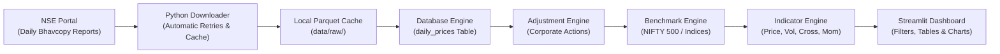

# NSE Screener: Stock Screener & Trading Terminal for NSE India

[](https://www.python.org/downloads/)
[](https://streamlit.io/)
[](https://www.mysql.com/)
[](https://www.sqlalchemy.org/)
[](https://alembic.sqlalchemy.org/)
[](LICENSE)

A clean, fast, and automated stock screener and market terminal for stocks on the **National Stock Exchange of India (NSE)**.

The system automatically downloads official daily NSE Bhavcopy market reports, saves clean price history into a MySQL database with corporate action adjustments (splits/bonuses), calculates modular technical indicators (grouped by price, volume, crossovers, and momentum), and displays filtered stock setups on a modern, dark-themed **Streamlit** web terminal.

---

## 🎯 What Problem Does This Solve?

When scanning and analyzing Indian equities, traders and investors frequently run into several practical challenges:

1. **Penny Stock Clutter & Low Liquidity:** There are over 2,000 listed stocks on the NSE. Scanning all of them includes illiquid, micro-cap stocks with unpredictable swings and execution risks.
2. **Fragile NSE Downloads:** Downloading daily reports directly from the exchange often breaks because of network timeouts, rate limits, or missing trading holiday data.
3. **Corporate Actions Distorting Technicals:** Stock splits and bonus issues create artificial price drops on unadjusted charts, triggering false breakdown signals and invalidating moving averages.
4. **Time-Consuming Manual Scanning:** Finding stocks that have strong uptrends, unusual volume surges, and healthy price momentum usually requires manually checking hundreds of charts each day.

**NSE Screener** automates the entire process:
- **Filters the Top 500 Quality Stocks:** Strictly tracks constituents of **NIFTY 100**, **NIFTY Midcap 150**, and **NIFTY Smallcap 250**.
- **Smart & Reliable Downloader:** Downloads daily Bhavcopies with browser session handling, retries, and local file caching so you never download the same day twice.
- **Corporate Action Split/Bonus Adjustments:** Detects splits/bonuses using official NSE previous closes and continuously computes split-adjusted prices (`adj_open`, `adj_high`, `adj_low`, `adj_close`).
- **Benchmark Ingestion:** Ingests official NSE index benchmarks (`NIFTY 50`, `NIFTY 500`, etc.) and aligns stock performance against the broader market.
- **Calculates 35+ Domain-Grouped Indicators:** Computes moving averages (SMA, EMA), Bollinger Bands, RSI, MACD, Volume ratios, 52-week rolling highs, and relative strength vs NIFTY 500.
- **Interactive Web Terminal:** Displays ready-to-trade swing setups, customizable tables, and multi-panel candlestick charts with decoupled, high-performance caching.

---

## 🏗️ How It Works (Project Workflow)

The project follows a simple, robust pipeline:



### Key Workflow Highlights
- **Smart Downloader (`src/ingestion/downloader.py`):** Connects to the NSE portal using browser-like headers, handles session cookies, and falls back across new and historical archive formats. Detailed column specifications are documented in [docs/bhavcopy_columns.md](docs/bhavcopy_columns.md).
- **Benchmark Indices (`src/ingestion/benchmark.py`):** Downloads and normalizes official NSE index files with canonical codes detailed in [docs/index_files.md](docs/index_files.md).
- **Safe Database Loader (`src/etl/pipeline.py`):** Loads rows in bounded chunks using dialect-agnostic upserts (`INSERT ... ON DUPLICATE KEY UPDATE` on MySQL, `ON CONFLICT DO UPDATE` on SQLite).
- **Corporate Action Adjustments (`src/etl/adjust.py`):** Detects splits and bonus issues, enforces cross-sectional sanity checks, and vectorizes cumulative factor adjustments.
- **Indicators Grouped by Nature (`src/computation/indicators/`):**
  - `price.py`: SMA, EMA, WMA, Bollinger Bands, ATR, 52-week High/Low, rolling volatility.
  - `volume.py`: Volume SMAs, volume expansion ratios, dry-up volume tests.
  - `crossovers.py`: Golden Cross, Death Cross, MACD crossovers.
  - `momentum.py`: RSI, MACD histogram, Relative Strength vs benchmark, cross-sectional percentile rankings.
- **High-Performance UI (`ui/data.py`):** Uses Streamlit caching with multi-factor cache tokens tied to Parquet mtime and metadata sidecar hashes.

---

## 💻 Tech Stack

| Component | Technologies Used | What It Does |
| :--- | :--- | :--- |
| **Language** | Python 3.11+ | Main programming language for scripts, calculations, and the UI. |
| **Data Processing** | Pandas, NumPy, PyArrow | Fast data cleaning, vectorised rolling calculations, and Parquet caching. |
| **Database** | MySQL 8.0, PyMySQL, SQLite | Stores daily stock prices, trading volumes, and index categories. |
| **Database Layer** | SQLAlchemy 2.0, Alembic | Manages schema migrations, connection pooling, and dialect-agnostic upserts. |
| **Web Dashboard** | Streamlit, Plotly | Interactive terminal with dark mode, custom filters, and candlestick charts. |
| **Networking** | Requests | Downloads market reports with session cookies and retry handlers. |
| **Testing & Quality** | Pytest, Ruff | Automated test suite verifying data logic, indicators, and UI pages. |

---

## 🗄️ Database Migrations with Alembic

The database schema is fully managed with **Alembic**.

```bash
# Apply all pending migrations to current HEAD
alembic upgrade head

# Inspect current revision status
alembic current
```

---

## 📐 Quantitative Screener Platform

The project features an extensible, pluggable screener platform (`src/screeners/`) where screening rules are organized strictly by their nature (**Price**, **Volume**, **Crossover**, **Momentum**). Every screener supports execution (`run()`) and deep diagnostic introspection (`explain()`), including **near-miss detection** (identifying equities that passed all criteria except a single bottleneck condition).

### 1. Registered Systematic Screeners

| Key | Name | Category | Primary Setup Logic |
| :--- | :--- | :--- | :--- |
| `minervini_trend_template` | **Minervini Trend Template** | Trend | Mark Minervini's 8-point Stage 2 trend template (Close > 50 > 150 > 200 SMA, upward-sloping 200 SMA, +30% from 52W Low, within 25% of 52W High, RS leader). |
| `breakout_52w_volume` | **52W High Breakout + Vol** | Breakout | Price within 2% or breaking 52-week High with heavy institutional volume surge (>= 2.0x 20D SMA) and minimum liquidity. |
| `rsi_pullback_uptrend` | **RSI Pullback in Uptrend** | Pullback | Orderly, low-volume pullback (Vol <= 1.2x SMA) to bull market support zone (RSI 40-55) in an established uptrend (Close > 50 SMA > 200 SMA). |
| `vcp_lite` | **VCP Lite (Volatility Contraction)** | Breakout | Volatility compression (ATR% <= 75% of 60D max ATR% or narrow Bollinger width) accompanied by volume dry-up (Vol <= 0.7x SMA) in an uptrend. |
| `rs_leaders` | **Relative Strength Leaders** | Quantitative | Outperforming equities with RS 63D > 10% vs NIFTY 500 or top 20th percentile 252D return rank, trading above moving averages. |
| `composite_trend` | **Composite Trend Regime** | Trend | Multi-indicator regime confluence: Close > 20 EMA & 50 SMA, recent Golden Cross or MA support, bullish MACD, RSI >= 50, and healthy volume. |
| `swing_volume` | **Swing + Volume** | Swing | Uptrend alignment (EMA 20 > SMA 50 > SMA 200), within 15% of 52-week high, volume surge (> 1.5x 20D SMA), 20D SMA volume > 250k. |
| `swing_momentum` | **Swing With Momentum** | Swing | Meets all Swing + Volume criteria with multi-quarter velocity (120D return >= 30%) and an anti-climax exhaustion guard (60D return <= 40%). |
| `above_50_sma` / `above_200_sma` | **Above 50 / 200 SMA** | Classic | Classical moving average threshold filters. |
| `golden_cross` / `death_cross` | **Golden / Death Cross** | Classic | State transition crossovers between 50 SMA and 200 SMA. |
| `near_52w_high` / `near_52w_low` | **Near 52W High / Low** | Classic | Proximity filters to 52-week extremes. |
| `rsi_oversold` / `rsi_overbought` | **RSI Oversold / Overbought**| Classic | Momentum oscillator extremes (RSI < 30 or RSI > 70). |
| `bullish_macd_crossover` | **Bullish MACD Cross** | Classic | MACD line crossing above 9-day signal line. |
| `high_volatility` / `bollinger_squeeze` | **Volatility & Squeeze** | Classic | Historical volatility thresholds and Bollinger Band compression. |

---

### 2. Grouped Conditions Architecture

Screening conditions are decoupled from screeners and modularized in `src/screeners/conditions/` by their nature:
- **`price.py`**: Moving average alignment, price boundaries, 52-week proximity, volatility, and ATR contraction.
- **`volume.py`**: Volume surges, liquidity floors, and volume dry-up ratios.
- **`crossover.py`**: Golden Cross, Death Cross, MACD crossovers, and recent crossing events (10-session lookback).
- **`momentum.py`**: RSI support/extremes, benchmark relative strength, cross-sectional percentile rankings, and return velocity caps/floors.

### 3. Programmatic Usage Example

```python
from src.screeners import get_screener

# Instantiate any registered screener
screener = get_screener("minervini_trend_template")

# Run screener to get passing stocks
passing_stocks = screener.run(snapshot_df)

# Deep diagnostic explainability with near-miss analysis
explained_df = screener.explain(snapshot_df)

# Find near-miss stocks that failed by only 1 condition
near_misses = explained_df[explained_df["near_miss"]]
print(near_misses[["symbol", "near_miss_on"]])
```

---

## 🚀 Quickstart Guide (macOS / VS Code)

Follow these steps to get the project up and running locally:

### 1. Clone the Project & Create Virtual Environment
```bash
# Clone the repository
git clone https://github.com/YashSharma333/nse-screener.git
cd nse-screener

# Create and activate virtual environment
python3 -m venv .venv
source .venv/bin/activate

# Install required packages
pip install --upgrade pip
pip install -r requirements-dev.txt
```

### 2. Set Up Environment Variables
Copy the sample environment file:
```bash
cp .env.example .env
```
Open `.env` and set your local MySQL connection settings:
```env
MYSQL_HOST=localhost
MYSQL_PORT=3306
MYSQL_USER=root
MYSQL_PASSWORD=your_password
MYSQL_DB=nse_screener
```

### 3. Initialize the Database Schema
Ensure your MySQL server is running, then run Alembic migrations:
```bash
alembic upgrade head
```

### 4. Ingest Market Data via CLI

```bash
# Incremental update: fetch recent trading sessions (fastest)
python run_pipeline.py --incremental

# Backfill historical data in chunked batches (e.g. past 365 days)
python run_pipeline.py --backfill --days-back 365

# Full historical backfill (default 1100 days, ~3 years)
python run_pipeline.py --backfill

# Recompute corporate actions (splits/bonuses) and update database
python run_pipeline.py --rebuild-adjusted

# Download and ingest benchmark index prices standalone
python run_pipeline.py --benchmarks

# Rebuild indicators Parquet cache without re-downloading
python run_pipeline.py --refresh-cache
```

### 5. Launch the Dashboard
Start the web dashboard:
```bash
streamlit run ui/Dashboard.py
```
Open [http://localhost:8501](http://localhost:8501) in your web browser.

> [!NOTE]
> **Data Availability:** Synthetic demo-mode data was removed in Phase 1; live MySQL or Parquet cache is required to run the application. If your database is empty, the dashboard displays a setup banner with the exact CLI commands to initialize and backfill data.

### 6. Run the Test Suite & Linters
```bash
# Run full test suite with coverage
pytest

# Run linter and formatter check
ruff check .
ruff format --check .
```

---

## 📂 Project Structure

```
nse-screener/
├── config/
│   └── settings.py               # Central logging and path configuration
├── data/
│   ├── raw/bhavcopy_cache/       # Local Parquet cache for downloaded market files
│   └── processed/                # Pre-computed indicator snapshots & sidecars
├── docs/
│   ├── bhavcopy_columns.md       # Raw Bhavcopy format specification & historical URL tests
│   └── index_files.md            # Verified NSE benchmark index codes & URLs
├── migrations/                   # Alembic database migration revisions
├── src/
│   ├── computation/
│   │   └── indicators/           # Technical indicators grouped by nature:
│   │       ├── price.py          # Price indicators (MAs, BB, ATR, 52W High/Low)
│   │       ├── volume.py         # Volume indicators (Volume SMA, Volume ratio)
│   │       ├── crossovers.py     # Crossover indicators (Golden/Death cross, MACD)
│   │       ├── momentum.py       # Momentum indicators (RSI, RS vs benchmark)
│   │       └── calculator.py     # TechnicalCalculator orchestrator facade
│   ├── db/
│   │   ├── data_service.py       # Indicator cache loader, sidecar validation & DB queries
│   │   ├── models.py             # SQLAlchemy models (DailyPrice, AdjFactor, etc.)
│   │   ├── session.py            # MySQL engine, connection pooling & health checks
│   │   └── upsert.py             # Dialect-agnostic upsert helper (MySQL & SQLite)
│   ├── etl/
│   │   ├── adjust.py             # Corporate action split/bonus detector & adjuster
│   │   └── pipeline.py           # Bhavcopy ETL pipeline & backwards chunked backfill
│   ├── ingestion/
│   │   ├── benchmark.py          # Benchmark index downloader & loader
│   │   ├── downloader.py         # NSE Bhavcopy file downloader with retries
│   │   └── index_constituents.py # NIFTY constituent fetcher & snapshotter
│   └── screeners/                # Extensible Screener Platform
│       ├── base.py               # Screener abstract base class & explainability
│       ├── registry.py           # Pluggable screener registry & discovery
│       ├── conditions/           # Screening conditions grouped by nature:
│       │   ├── price.py          # Price-based screening conditions
│       │   ├── volume.py         # Volume & liquidity screening conditions
│       │   ├── crossover.py      # Line crossing & transition conditions
│       │   └── momentum.py       # RSI, RS & return velocity conditions
│       ├── swing.py              # Capstone Swing + Volume & Swing With Momentum
│       ├── classic.py            # 11 classic technical filter screens
│       └── strategies.py         # 6 systematic strategies (Minervini, VCP, etc.)
├── tests/                        # Comprehensive unit & integration tests
├── ui/
│   ├── app.py                   # Streamlit multipage app router
│   ├── data.py                  # Streamlit cache wrapper with multi-factor tokens
│   ├── Dashboard.py             # Main screener dashboard page
│   ├── components/              # Reusable UI components (terminal header, screener view)
│   └── pages/
│       ├── 2_swing_volume.py    # Screener page: Swing + Volume
│       ├── 3_swing_momentum.py  # Screener page: Swing With Momentum
│       └── 4_screener_explorer.py # Interactive Screener Explorer & Diagnostics
├── pyproject.toml               # Project configuration, ruff & pytest-cov settings
├── requirements.txt             # Runtime Python dependencies
├── requirements-dev.txt         # Development & test dependencies
└── run_pipeline.py              # CLI tool for data ingestion and ETL operations
```

---

## 👤 Author
- **Developer:** Yash Sharma
- **Focus:** Data Engineering, Python Development & Stock Market Analytics
